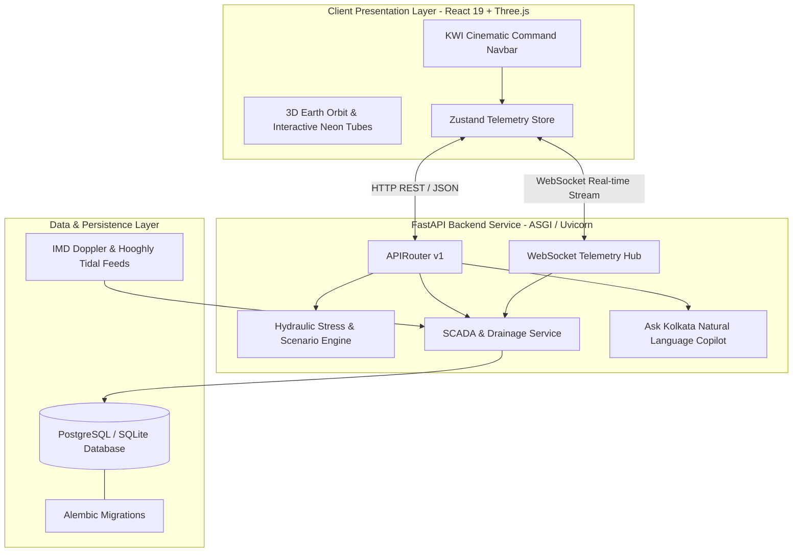

<div align="center">

# 🌊 KOLKATA WATER INTELLIGENCE
### **AI-Unleashed // High-Performance FastAPI & 3D WebGL Municipal Command Engine**

<p align="center">
  <em>"Know the Water. Know the City."</em>
</p>

<p align="center">
  
  
  
  
  
</p>

<p align="center">
  
  
  
  
  
</p>

<br />

---

</div>

## 📑 Table of Contents
- [Executive Overview](#-executive-overview)
- [System Architecture](#-system-architecture)
- [FastAPI High-Performance Backend Engine](#-fastapi-high-performance-backend-engine)
- [API Endpoints & Telemetry Matrix](#-api-endpoints--telemetry-matrix)
- [Frontend & 3D WebGL Visualization](#-frontend--3d-webgl-visualization)
- [Quick Start Guide](#-quick-start-guide)
- [Repository Structure](#-repository-structure)
- [License](#-license)

---

## 🌐 Executive Overview

**Kolkata Water Intelligence (KWI)** is an asynchronous municipal geospatial telemetry and hydrometeorological intelligence platform engineered for the **Kolkata Municipal Corporation (KMC)** Sewerage & Drainage Directorate. 

The system unifies real-time hydrological modeling, SCADA pumping network telecontrol, tidal lock forecasting on the Hooghly River, and 3D geospatial visualization into a single unified platform.

```
┌─────────────────────────────────────────────────────────────────────────────────────────┐
│                                   CORE CAPABILITIES                                     │
├──────────────────────────┬──────────────────────────┬───────────────────────────────────┤
│  ⚡ FastAPI Backend      │  🌊 Hydraulic Engine     │  🛰️ 3D WebGL Canvas              │
│  Async REST + WebSockets │  Real-time tidal lock &  │  Three.js planetary ingress and   │
│  with Pydantic validation│  drainage scenario model │  interactive fluid neon tubes     │
└──────────────────────────┴──────────────────────────┴───────────────────────────────────┘
```

---

## 🏛️ System Architecture



---

## ⚡ FastAPI High-Performance Backend Engine

The backend is built with **FastAPI** to handle high-concurrency SCADA telemetry streams and computationally intensive hydraulic modeling:

- **Asynchronous ASGI Architecture**: Powered by `asyncio` and `uvicorn` for ultra-low latency request execution.
- **Strict Data Validation**: Utilizes **Pydantic v2** models for automatic type verification and error handling.
- **Real-Time WebSockets**: Pub/Sub broadcasting for live water depth (cm), pump statuses, and sluice gate locks.
- **Asynchronous ORM**: **SQLAlchemy 2.0 (async)** with connection pooling and **Alembic** schema migrations.
- **Interactive Documentation**: Auto-generated interactive OpenAPI docs available at `/docs` (Swagger UI) and `/redoc` (ReDoc).

---

## 📡 API Endpoints & Telemetry Matrix

| Method | Endpoint | Description | Query / Body Payload | Response |
| :--- | :--- | :--- | :--- | :--- |
| `GET` | `/api/v1/health` | Service health & telemetry sync status | None | `{"status": "healthy", "sync": true}` |
| `GET` | `/api/v1/incidents` | List active municipal waterlogging incidents | `?borough=VII&severity=CRITICAL` | `List[IncidentSchema]` |
| `POST` | `/api/v1/incidents/{id}/resolve` | Resolve/dispatch incident work order | None | `IncidentSchema` |
| `GET` | `/api/v1/forecast/radar` | Alipore Doppler rainfall curve & tides | `?hours=24` | `ForecastPayload` |
| `POST` | `/api/v1/simulate` | Execute hydraulic scenario simulation | `{"rainfall_mm": 65, "tide_m": 3.6, "pump_cap": 90}` | `SimulationResultSchema` |
| `GET` | `/api/v1/reports` | Retrieve KMC drainage briefs & audit PDFs | `?status=PUBLISHED` | `List[ReportSchema]` |
| `POST` | `/api/v1/actions/{id}/toggle` | SCADA pump actuation & sluice throttle | `{"token": "SCADA-942"}` | `ActionStatusSchema` |
| `POST` | `/api/v1/copilot/ask` | Natural language Ask Kolkata Copilot query | `{"query": "Water level at Ward 49"}` | `CopilotResponseSchema` |
| `WS` | `/api/v1/ws/telemetry` | Real-time live SCADA telemetry stream | WebSocket Connection | Continuous JSON Event Stream |

---

## 🎨 Frontend & 3D WebGL Visualization

### 🌌 Floating Cinematic Command Navbar
- **Surface**: Near-black translucent surface (`#080c12`/`78%` opacity with `backdrop-filter: blur(16px)`).
- **Subtle Edge Gradient**: 1px border transitioning from cool blue (`rgba(56,189,248,0.2)`) $\rightarrow$ neutral (`rgba(255,255,255,0.1)`) $\rightarrow$ teal (`rgba(45,212,191,0.2)`).
- **Measurement Signal Indicator**: Precision Framer Motion active indicator line gliding between navigation destinations.
- **Typography**: Clean municipal hierarchy: `KOLKATA WATER` + `INTELLIGENCE` + `LIVE CITY`.

### 🧪 WebGL Neon Tubes Canvas
- Built with Three.js custom shaders tracking cursor velocities with interactive click-to-randomize color palettes.

---

## 🚀 Quick Start Guide

### 📋 Prerequisites
- **Python**: `>= 3.10`
- **Node.js**: `>= 18.0.0`
- **npm**: `>= 9.0.0`

---

### 1️⃣ Start the FastAPI Backend Server

```bash
# Navigate to Backend
cd Backend

# Create Python Virtual Environment
# Windows (PowerShell):
python -m venv venv
.\venv\Scripts\Activate.ps1

# macOS / Linux:
python3 -m venv venv
source venv/bin/activate

# Install Dependencies
pip install -r requirements/requirements.txt

# Run Database Migrations
alembic upgrade head

# Start FastAPI Uvicorn Server
uvicorn app.main:app --reload --host 0.0.0.0 --port 8000
```

> 📖 **API Docs**: Access interactive Swagger UI at **`http://localhost:8000/docs`**  
> 📑 **ReDoc**: Access ReDoc documentation at **`http://localhost:8000/redoc`**

---

### 2️⃣ Start the React 19 Frontend

```bash
# In a separate terminal, navigate to Frontend
cd Frontend

# Install Dependencies
npm install

# Start Local Dev Server
npm run dev
```

> 🌐 **Frontend URL**: Access the WebGL application at **`http://localhost:5173`**

---

## 📁 Repository Structure

```text
Ai-Unleashed/
├── Backend/                      # FastAPI Python Application
│   ├── alembic/                  # Alembic DB migration version files
│   ├── app/
│   │   ├── api/v1/               # Versioned route controllers & endpoints
│   │   ├── core/                 # Config settings, logging & CORS
│   │   ├── engines/              # Hydraulic scenario calculators
│   │   ├── models/               # SQLAlchemy async database models
│   │   ├── schemas/              # Pydantic data schemas
│   │   ├── services/             # Incident & SCADA telemetry services
│   │   └── websocket/            # WebSocket broadcaster hub
│   ├── requirements/             # Dependency specifications
│   └── README.md                 # Backend documentation
│
├── Frontend/                     # React 19 + Three.js Application
│   ├── public/                   # Static textures & models
│   ├── src/
│   │   ├── components/
│   │   │   ├── 3d/               # TubesBackground.jsx, Earth.jsx
│   │   │   ├── landing/          # LandingPage.jsx
│   │   │   ├── navigation/       # KWINavbar.jsx
│   │   │   └── views/            # Municipal operational view components
│   │   ├── store/                # useKWIStore.js (Zustand state)
│   │   ├── App.jsx               # Master stage transition controller
│   │   ├── App.css               # Design system tokens & glass styling
│   │   └── main.jsx              # React DOM entry
│   ├── package.json              # NPM scripts & dependencies
│   └── vite.config.js            # Vite + Tailwind v4 build config
│
└── README.md                     # Global project documentation
```

---

## 📄 License

Distributed under the **MIT License**. See `LICENSE` for details.

<div align="center">
  <sub>Developed for <strong>Kolkata Water Intelligence</strong> // © 2026 AI-Unleashed</sub>
</div>
