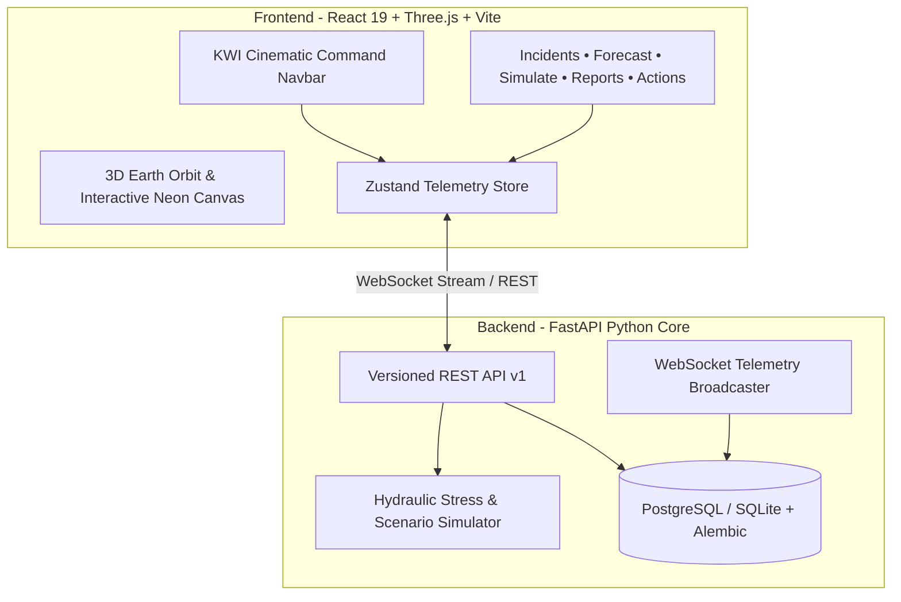

<div align="center">

# 🌊 KOLKATA WATER INTELLIGENCE
### **AI-Unleashed // Municipal GIS & Hydrometeorological Command Engine**

<p align="center">
  <em>"Know the Water. Know the City."</em>
</p>

[](https://react.dev/)
[](https://threejs.org/)
[](https://vitejs.dev/)
[](https://tailwindcss.com/)
[](https://motion.dev/)
[](https://www.python.org/)
[](https://fastapi.tiangolo.com/)
[](https://opensource.org/licenses/MIT)

<br />

---

</div>

## 📑 Table of Contents
- [Executive Overview](#-executive-overview)
- [System Architecture](#-system-architecture)
- [Core Capabilities](#-core-capabilities)
- [Visual Experience & Design System](#-visual-experience--design-system)
- [Technology Matrix](#-technology-matrix)
- [Getting Started](#-getting-started)
- [Directory Structure](#-directory-structure)
- [License](#-license)

---

## 🌐 Executive Overview

**Kolkata Water Intelligence (KWI)** is an enterprise municipal geospatial command and telemetry platform. Built for the Kolkata Municipal Corporation (KMC) Sewerage & Drainage Directorate, the system unifies:

- **Real-time Inundation Telemetry** across 16 Boroughs and 144 Wards.
- **Hydraulic River & Sluice Modeling** tracking Hooghly bore tides and gravity drainage locks.
- **AI Scenario Simulation** predicting waterlogging clearance time under variable precipitation curves.
- **Cinematic 3D WebGL Visualization** featuring planetary orbit-to-city camera zoom and reactive fluid neon tubes.

---

## 🏛️ System Architecture



---

## ⚡ Core Capabilities

<table>
  <tr>
    <td width="50%">
      <h3 align="left">🛰️ 3D Planetary & City Ingress</h3>
      <p>Cinematic orbital camera rotation around high-resolution photorealistic Earth with a seamless spline transition to Kolkata.</p>
    </td>
    <td width="50%">
      <h3 align="left">🧪 Interactive Neon Tubes Canvas</h3>
      <p>High-performance WebGL cursor velocity tracker with real-time 3D tube geometry and click-to-randomize color shifts.</p>
    </td>
  </tr>
  <tr>
    <td width="50%">
      <h3 align="left">📊 Real-Time Incident Telemetry</h3>
      <p>Automated logging of critical waterlogging depth (cm), pump station capacity, and ward dispatch priority.</p>
    </td>
    <td width="50%">
      <h3 align="left">🌊 Tidal & Precipitation Engine</h3>
      <p>Alipore Doppler radar curve integration combined with Hooghly River tidal lock and sluice gate scheduling.</p>
    </td>
  </tr>
</table>

---

## 🎨 Visual Experience & Design System

### 🌌 Floating Cinematic Command Navbar
The primary navigation embodies a quiet, technical, and architectural aesthetic tailored for dark space visualization:

```
╭─────────────────────────────────────────────────────────────────────────────────────────────────╮
│  KOLKATA WATER INTELLIGENCE  LIVE CITY    CITY  INCIDENTS  FORECAST  SIMULATE  REPORTS  ACTIONS │
│                                                                        [ ASK KOLKATA ↗ ]  ADMIN │
╰─────────────────────────────────────────────────────────────────────────────────────────────────╯
```

- **Material**: Near-black translucent glass (`#080c12`/`78%` opacity with `backdrop-filter: blur(16px)`).
- **Border**: Subtle 1px gradient edge (`rgba(56,189,248,0.2) → rgba(255,255,255,0.1) → rgba(45,212,191,0.2)`).
- **Signature Indicator**: Framer Motion animated geographic measurement line gliding smoothly along active sections.
- **Zero Distractions**: Clean editorial typography without noisy emojis, sparkle icons, or artificial neon glows.

---

## 💻 Technology Matrix

| Layer | Package | Purpose |
| :--- | :--- | :--- |
| **Frontend Framework** | `react@19.2.8` | Core UI engine |
| **Bundler & Dev Server**| `vite@8.2.2` | Ultra-fast HMR and build pipeline |
| **3D & Shaders** | `three@0.185.1`, `@react-three/fiber` | WebGL canvas, 3D Earth, and dynamic neon tubes |
| **Motion & Physics** | `motion@13.1.1` (Framer Motion) | Precision layoutId indicators and view transitions |
| **Styling** | `tailwindcss@4.3.3` | Utility styling and CSS custom property tokens |
| **State Management** | `zustand@5.0.15` | Centralized telemetry and navigation store |
| **Iconography** | `lucide-react` | Precision functional arrows and controls |
| **Backend Core** | `Python 3.10+`, `FastAPI` | Asynchronous REST endpoints and WebSocket feeds |
| **Database & Migrations**| `SQLAlchemy`, `Alembic` | Entity modeling and schema versioning |

---

## 🚀 Getting Started

### 📋 Prerequisites
- **Node.js**: `>= 18.0.0`
- **npm**: `>= 9.0.0`
- **Python**: `>= 3.10`

---

### 1️⃣ Frontend Quickstart

```bash
# 1. Navigate to frontend directory
cd Frontend

# 2. Install dependencies
npm install

# 3. Launch local dev server
npm run dev
```

> 🌐 **Application URL**: Open [http://localhost:5173](http://localhost:5173) in your browser.

```bash
# Production Build
npm run build

# Preview Production Build
npm run preview
```

---

### 2️⃣ Backend Quickstart

```bash
# 1. Navigate to backend directory
cd Backend

# 2. Create and activate virtual environment
# Windows (PowerShell):
python -m venv venv
.\venv\Scripts\Activate.ps1

# macOS / Linux:
python3 -m venv venv
source venv/bin/activate

# 3. Install requirements
pip install -r requirements/requirements.txt

# 4. Run database migrations
alembic upgrade head
```

---

## 📁 Directory Structure

```text
Ai-Unleashed/
├── Backend/
│   ├── alembic/                  # Database migration scripts
│   ├── app/
│   │   ├── api/v1/               # REST API route handlers
│   │   ├── core/                 # Config, security, database sessions
│   │   ├── engines/              # Hydraulic scenario calculators
│   │   ├── models/               # SQLAlchemy ORM models
│   │   ├── schemas/              # Pydantic validation schemas
│   │   ├── services/             # Incident & telemetry business logic
│   │   └── websocket/            # Live telemetry broadcaster
│   ├── requirements/             # Python dependency specifications
│   └── README.md                 # Backend documentation
│
├── Frontend/
│   ├── public/                   # Textures, models & static assets
│   ├── src/
│   │   ├── components/
│   │   │   ├── 3d/               # TubesBackground.jsx, Earth.jsx
│   │   │   ├── landing/          # LandingPage.jsx
│   │   │   ├── navigation/       # KWINavbar.jsx, AskKolkataDrawer.jsx
│   │   │   └── views/            # Incidents, Forecast, Simulate, Reports, Actions
│   │   ├── store/                # useKWIStore.js (Zustand)
│   │   ├── App.jsx               # Master stage transition orchestrator
│   │   ├── App.css               # Design system tokens & glass styles
│   │   └── main.jsx              # React application root
│   ├── package.json              # NPM dependencies & scripts
│   └── vite.config.js            # Vite + Tailwind v4 build configuration
│
└── README.md                     # Global project documentation
```

---

## 📄 License

Distributed under the **MIT License**. See `LICENSE` for more information.

<div align="center">
  <sub>Designed & Developed for <strong>Kolkata Water Intelligence</strong> // © 2026 AI-Unleashed</sub>
</div>
