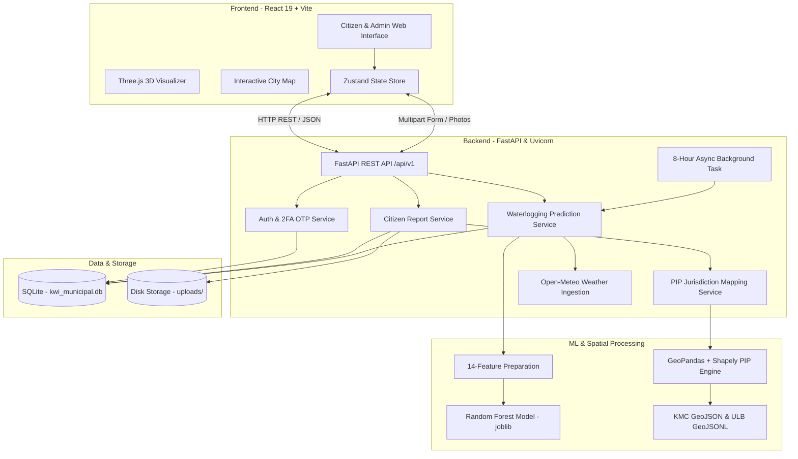

<div align="center">

# 🌊 NIVARA
### **Intelligent Metropolitan Drainage & Waterlogging Prediction System**

<p align="center">
  <em>Predictive Municipal Waterlogging Analytics & Crowdsourced Citizen Reporting for Kolkata</em>
</p>

<p align="center">
  
  
  
  
  
  
  
  
</p>

</div>

---

## 📑 Table of Contents
1. [Project Title & Description](#1-project-title--description)
2. [Features](#2-features)
3. [Architecture Overview](#3-architecture-overview)
4. [Tech Stack](#4-tech-stack)
5. [Repository Structure](#5-repository-structure)
6. [Prerequisites](#6-prerequisites)
7. [Installation & Setup (Localhost)](#7-installation--setup-localhost)
8. [Environment Variables](#8-environment-variables)
9. [API Endpoints](#9-api-endpoints)
10. [Database Schema](#10-database-schema)
11. [Data Flow & Architecture](#11-data-flow--architecture)
12. [Authentication & Security](#12-authentication--security)
13. [Testing](#13-testing)
14. [Deployment Status](#14-deployment-status)
15. [Contributing](#15-contributing)
16. [License](#16-license)
17. [Team & Credits](#17-team--credits)
18. [Roadmap & Future Scope](#18-roadmap--future-scope)

---

## 1. Project Title & Description

### Project Title
**NIVARA: Intelligent Metropolitan Drainage & Waterlogging Prediction System**

### Problem Statement
In Kolkata and surrounding metropolitan areas, the urban drainage network is extensive, complex, and aging. It suffers from severe maintenance and operational hurdles:
1. **Lack of cleaning prior to rainfall**: Desilting and drain clearance are rarely prioritized according to where heavy rain will accumulate most critically.
2. **Lack of information on blockages and pitfalls**: When drains are choked with plastic or silt, or when low-lying pockets begin to flood, municipal authorities lack real-time visibility until neighborhoods are already inundated.

As a result, even moderate to heavy rainfall triggers widespread waterlogging across major streets and residential colonies, disrupting transit, damaging property, and endangering public safety.

### The NIVARA Solution
**NIVARA** is an integrated software platform that maps city drainage positions and tackles urban waterlogging through two core operational capabilities:
1. **Predictive Waterlogging Intelligence**: Automatically predicts waterlogging probabilities and risk levels across **166+ localities** by integrating live weather forecasts (via Open-Meteo API) with a trained Random Forest machine learning model factoring in terrain elevation, slope, and soil moisture.
2. **Real-Time Citizen Reporting**: Enables local residents to submit real-time reports of drain blockages and standing water, complete with original photographs, water depth, and GPS coordinates.
3. **Automated Administrative Ward Mapping**: Uses spatial Point-in-Polygon (PIP) joins to automatically assign each report to its exact Kolkata Municipal Corporation (KMC) ward or Urban Local Body (ULB).
4. **Municipal Command Dashboard**: Displays an interactive map with color-coded risk indicators (High, Medium, Low) and citizen-reported issues so municipal engineers can prioritize desilting and dispatch response teams efficiently.

---

## 2. Features

### 🌦️ AI-Powered Waterlogging Prediction
- **166+ Monitored Localities**: Covers key municipal wards and localities across Kolkata and adjacent Urban Local Bodies.
- **Dynamic Weather Forecasting**: Fetches live rainfall and soil moisture forecasts via the Open-Meteo API.
- **Transparent Risk Scoring**:
  - **Probability ($0.0 - 1.0$)**: Combines baseline terrain susceptibility with forecast rainfall volume.
  - **Severity ($0.0 - 1.0$)**: Evaluates physical consequences based on elevation, slope, and soil saturation.
  - **Priority Score ($0.0 - 1.0$)**: Weighted composite metric ($0.45 \times \text{Prob} + 0.35 \times \text{Severity} + 0.20 \times \text{Impact}$) ranking locations from most critical to least critical.
  - **Risk Tiers**: Automatically categorizes localities into `HIGH`, `MEDIUM`, or `LOW` risk.
- **Background Scheduler**: Runs an automatic prediction refresh cycle every 8 hours using asynchronous tasks.

### 📍 Spatial Municipality & Ward Mapping
- **Point-in-Polygon (PIP) Routing**: Uses GeoPandas and Shapely to match coordinates against official vector boundaries:
  - **Kolkata Municipal Corporation (KMC)**: Identifies the exact ward across all 141 KMC wards.
  - **West Bengal AMRUT ULBs**: Resolves jurisdictions across 57 Municipalities and Corporations (e.g., Bidhannagar, Howrah, South Dum Dum).
- **Forward Geocoding**: Converts typed street addresses into latitude/longitude coordinates via OpenStreetMap Nominatim when GPS is unavailable.

### 📸 Citizen Crowdsourcing & Photo Reports
- **Photo Uploads**: Accepts genuine photographs of blocked drains and waterlogged roads. Images are stored on the local filesystem (`uploads/`) and served directly.
- **Report Details**: Captures estimated water depth (in feet/meters), issue category (e.g., Waterlogging, Drain Blockage), and descriptions.
- **User Ownership Isolation**: Citizens can review only their own past reports and track lifecycle status (`Under Review`, `Dispatched`, `Resolved`).

### 🛡️ Dual-Portal Role-Based Access & 2FA
- **Separate Portals**:
  - **Citizen Portal**: Register, log in, submit reports, and track report history.
  - **Admin Portal**: Restricted municipal officer access for viewing live city-wide risk maps, incident lists, and taking action.
- **Two-Factor Authentication (2FA)**: Dispatches a 6-digit OTP to the user's email via Gmail SMTP or mobile phone via SMS before registration and login.
- **Password Security**: Passwords hashed using Bcrypt/Argon2; authenticated sessions secured with signed JWT access tokens.

### 🖥️ Interactive Web Frontend
- **3D Earth Intro**: Three.js WebGL Earth visualization with smooth transition to the application.
- **Interactive City Map**: Visualizes localities and incidents with color-coded risk markers.
- **Municipal Command Views**: Dedicated views for Live City data, incident tracking, reports, and scenario simulations.

---

## 3. Architecture Overview



---

## 4. Tech Stack

### Backend
- **Python**: `3.10+`
- **FastAPI**: Asynchronous web framework for REST API endpoints
- **Uvicorn**: ASGI server
- **SQLAlchemy 2.0 (Async)** & **Aiosqlite**: Asynchronous database ORM with SQLite
- **Pydantic v2**: Request/response validation and serialization
- **PyJWT**: JSON Web Token authentication
- **Passlib & Bcrypt**: Secure password hashing
- **HTTPX**: Async HTTP client for weather API calls
- **Aiosmtplib**: Async SMTP client for sending 2FA OTP emails

### AI / Machine Learning & Geospatial
- **Scikit-Learn**: Machine learning pipeline and Random Forest inference
- **Joblib**: Loading serialized model artifacts (`waterlogging_model.joblib`)
- **GeoPandas & Shapely**: Point-in-Polygon spatial analysis
- **Pandas & NumPy**: Tabular data manipulation and feature engineering
- **GeoPy**: OpenStreetMap Nominatim geocoding

### Frontend
- **React 19**: Modern component-based user interface
- **Vite**: Frontend development server and build tool
- **Three.js & @react-three/fiber**: 3D WebGL Earth visualization
- **Leaflet & React-Leaflet**: Interactive map rendering
- **Zustand**: Client state management
- **Tailwind CSS v4**: UI styling and design
- **Framer Motion**: Interface animations
- **Lucide React**: Icons

---

## 5. Repository Structure

```text
Ai-Unleashed/
├── README.md                           # Master Documentation
├── Backend/                            # FastAPI Application
│   ├── app/
│   │   ├── api/v1/
│   │   │   ├── api.py                  # Mounts all v1 sub-routers
│   │   │   ├── auth.py                 # Auth, 2FA OTP, & profile routes
│   │   │   ├── reports.py              # Citizen report submission & retrieval
│   │   │   └── waterlogging.py         # Prediction list, summary, & refresh routes
│   │   ├── core/
│   │   │   ├── config.py               # Application settings (.env configuration)
│   │   │   ├── database.py             # Async SQLite engine & session setup
│   │   │   ├── datetime_utils.py       # Timezone-aware datetime utilities
│   │   │   └── security.py             # Password hashing & JWT helpers
│   │   ├── data/
│   │   │   ├── boundaries/             # Spatial boundary files
│   │   │   │   ├── kolkata.geojson     # KMC 141 wards vector boundary
│   │   │   │   └── WB_AMRUT_ULBs.geojsonl # 57 WB AMRUT ULB boundaries
│   │   │   └── waterlogging/
│   │   │       ├── kolkata_localities.csv # Baseline localities dataset
│   │   │       └── kolkata_localities_enriched.csv
│   │   ├── ml/
│   │   │   ├── feature_engineering.py  # 14-feature preparation for ML
│   │   │   ├── predictor.py            # Random Forest baseline susceptibility inference
│   │   │   ├── priority.py             # Priority score & risk level calculation
│   │   │   ├── severity.py             # Terrain & rainfall severity calculation
│   │   │   └── models/
│   │   │       └── waterlogging_model.joblib # Trained Random Forest model
│   │   ├── models/
│   │   │   ├── user.py                 # Citizen user model ('users' table)
│   │   │   ├── admin.py                # Municipal officer model ('admin' table)
│   │   │   ├── report.py               # Citizen incident report model ('reports' table)
│   │   │   └── waterlogging.py         # Prediction snapshot model ('waterlogging_predictions')
│   │   ├── schemas/
│   │   │   ├── auth.py                 # Auth request/response schemas
│   │   │   ├── report.py               # Report schemas
│   │   │   └── waterlogging.py         # Waterlogging prediction schemas
│   │   ├── services/
│   │   │   ├── auth_service.py         # User registration, login, & persona queries
│   │   │   ├── email_service.py        # Gmail SMTP email dispatcher
│   │   │   ├── geocoding_service.py    # Nominatim forward geocoder
│   │   │   ├── jurisdiction_service.py # GeoPandas Point-in-Polygon administrative engine
│   │   │   ├── otp_service.py          # 6-digit OTP generator & validator
│   │   │   ├── report_service.py       # Report creation, photo disk write, & user scoping
│   │   │   ├── waterlogging_service.py # Prediction cycle orchestrator & caching
│   │   │   └── weather_service.py      # Open-Meteo weather fetcher
│   │   └── main.py                     # FastAPI app instance, CORS, & background scheduler
│   ├── scripts/                        # Data preparation & inspection scripts
│   ├── uploads/                        # Citizen uploaded photo directory
│   ├── test_dual_tables.py             # Test suite for users/admin tables & auth
│   ├── test_jurisdiction_feature.py    # Test suite for Point-in-Polygon spatial joins
│   ├── test_waterlogging_pipeline.py   # Test suite for ML pipeline & prediction endpoints
│   ├── kwi_municipal.db                # SQLite database file
│   ├── requirements.txt                # Python backend dependencies
│   └── .env                            # Backend configuration file
│
└── Frontend/                           # React 19 Frontend
    ├── public/                         # Static assets (videos, icons)
    ├── src/
    │   ├── components/
    │   │   ├── 3d/                     # Earth and 3D scene components
    │   │   ├── auth/                   # AIUnleashedAuth login/signup UI
    │   │   ├── gis/                    # KolkataGisMap and cartographic data
    │   │   ├── mobile/                 # MobileReportForm citizen submission component
    │   │   ├── navigation/             # Navigation bars
    │   │   └── views/                  # LiveCityPage, ReportsView, SimulateView, ProfileView
    │   ├── store/                      # useKWIStore.js (Zustand state store)
    │   ├── utils/                      # API client (api.js) & datetime formatters
    │   ├── App.jsx                     # Master application component & route management
    │   ├── App.css                     # Glassmorphic and component styles
    │   ├── index.css                   # Tailwind CSS setup
    │   └── main.jsx                    # React entry point
    ├── package.json                    # Frontend dependencies
    └── vite.config.js                  # Vite build configuration
```

---

## 6. Prerequisites

Before running the project locally, ensure you have installed:
- **Python**: `>= 3.10`
- **Node.js**: `>= 18.0.0`
- **npm**: `>= 9.0.0`
- A modern web browser with WebGL enabled (Google Chrome, Microsoft Edge, Firefox, or Safari)

---

## 7. Installation & Setup (Localhost)

Follow these steps to run both the backend and frontend on your local machine:

### 1️⃣ Set Up & Run the Backend

1. **Open a terminal** and navigate to the `Backend` directory:
   ```bash
   cd Backend
   ```

2. **Create and activate a virtual environment**:
   - **Windows (PowerShell)**:
     ```powershell
     python -m venv venv
     .\venv\Scripts\Activate.ps1
     ```
   - **macOS / Linux**:
     ```bash
     python3 -m venv venv
     source venv/bin/activate
     ```

3. **Install Python dependencies**:
   ```bash
   pip install -r requirements.txt
   ```

4. **Verify / Configure `.env` file**:
   Ensure `Backend/.env` is present with your configuration (see [Environment Variables](#8-environment-variables)).

5. **Start the FastAPI server**:
   ```bash
   uvicorn app.main:app --reload --host 0.0.0.0 --port 8000
   ```

The backend server is now live at **`http://localhost:8000`**.  
Interactive Swagger API documentation is available at **`http://localhost:8000/docs`**.

---

### 2️⃣ Set Up & Run the Frontend

1. **Open a second terminal** and navigate to the `Frontend` directory:
   ```bash
   cd Frontend
   ```

2. **Install Node.js packages**:
   ```bash
   npm install
   ```

3. **Start the Vite development server**:
   ```bash
   npm run dev
   ```

The frontend application is now running at **`http://localhost:5173`**. Open this URL in your web browser to use NIVARA.

---

## 8. Environment Variables

The backend configuration is managed via `Backend/.env`. The key parameters are:

| Variable | Default Value | Description |
| :--- | :--- | :--- |
| `PROJECT_NAME` | `"Kolkata Water Intelligence"` | Application title |
| `API_V1_STR` | `"/api/v1"` | URL prefix for version 1 API endpoints |
| `DATABASE_URL` | `"sqlite+aiosqlite:///./kwi_municipal.db"` | Async SQLite database path |
| `SMTP_HOST` | `"smtp.gmail.com"` | SMTP host for sending 2FA emails |
| `SMTP_PORT` | `587` | SMTP port (TLS) |
| `SMTP_USER` | `""` | Gmail address used to dispatch 2FA OTPs |
| `SMTP_PASSWORD` | `""` | 16-character Google Account App Password |
| `FAST2SMS_API_KEY` | `""` | Optional SMS gateway key |
| `TWILIO_ACCOUNT_SID`| `""` | Optional Twilio Account SID |
| `TWILIO_AUTH_TOKEN` | `""` | Optional Twilio Auth Token |
| `TWILIO_PHONE_NUMBER`| `""` | Optional Twilio Sender Phone Number |

> 💡 **Setting up Free Email 2FA (Gmail)**:
> 1. Go to your Google Account Settings $\rightarrow$ Security $\rightarrow$ 2-Step Verification.
> 2. Search for **App Passwords**.
> 3. Generate a new App Password (name it `NIVARA`) and copy the 16-character string into `SMTP_PASSWORD` in `Backend/.env`.

---

## 9. API Endpoints

All primary application endpoints are prefixed with `/api/v1`:

### 🔐 Authentication (`/api/v1/auth`)
| Method | Endpoint | Description | Access |
| :--- | :--- | :--- | :--- |
| `POST` | `/api/v1/auth/signup` | Register a new Citizen or Admin account | Public |
| `POST` | `/api/v1/auth/login` | Log in and receive JWT token | Public |
| `POST` | `/api/v1/auth/admin/generate-otp` | Generate and send 6-digit OTP code to email or phone | Public |
| `POST` | `/api/v1/auth/admin/verify-otp` | Validate the 6-digit OTP code | Public |
| `GET` | `/api/v1/auth/me` | Fetch currently authenticated user profile | Authenticated |
| `PATCH`| `/api/v1/auth/me` | Update profile fields (name, phone, location) | Authenticated |
| `POST` | `/api/v1/auth/logout` | Mark user session inactive | Authenticated |

### 📢 Citizen Incident Reports (`/api/v1`)
| Method | Endpoint | Description | Access |
| :--- | :--- | :--- | :--- |
| `POST` | `/api/v1/reports` | Submit a waterlogging report with photo and coordinates | Authenticated (or fallback) |
| `GET` | `/api/v1/reports` | List all reports submitted by the logged-in user | Authenticated |
| `GET` | `/api/v1/reports/{report_id}` | View a specific report (ownership verified) | Authenticated |

### 🌊 Waterlogging Intelligence (`/api/v1/waterlogging`)
| Method | Endpoint | Description | Access |
| :--- | :--- | :--- | :--- |
| `GET` | `/api/v1/waterlogging/predictions` | Get latest locality predictions sorted by priority | Public / Authenticated |
| `GET` | `/api/v1/waterlogging/summary` | Get city-wide risk summary and top 5 priority hotspots | Public / Authenticated |
| `POST`| `/api/v1/waterlogging/refresh` | Manually trigger a fresh weather fetch & prediction cycle | Public / Authenticated |

---

## 10. Database Schema

The application uses **SQLite** (`kwi_municipal.db`) via **SQLAlchemy Async ORM** with four core tables:

### 1. `users` Table (Citizen Accounts)
- `id` (String, PK): Identifier (e.g., `USR-...`)
- `name` (String): Full name
- `email` (String, Unique): Email address
- `hashed_password` (String): Securely hashed password
- `phone` (String, Optional): Mobile phone number
- `role` (String): User role (e.g., `User`, `Community Lead Reporter`)
- `clearance` (String): Clearance label
- `status` (String): `active` or `not active`
- `created_at` (DateTime): Registration timestamp
- `location` (String, Optional): Residential area

### 2. `admin` Table (Municipal Staff Accounts)
- `id` (String, PK): Admin identifier (e.g., `ADM-...`)
- `badge_id` (String): Official badge ID
- `name` (String): Officer full name
- `email` (String, Unique): Official municipal email
- `hashed_password` (String): Securely hashed password
- `phone` (String, Optional): Phone number
- `role` (String): Admin role (e.g., `Admin`, `Executive Engineer`)
- `department` (String): Department name (e.g., `KMC Water & Drainage Administration`)
- `clearance` (String): Administrative clearance level
- `status` (String): `active` or `not active`
- `created_at` (DateTime): Account creation timestamp

### 3. `reports` Table (Citizen Reports)
- `id` (Integer, PK, Auto-increment)
- `report_id` (String, Unique): Public report ID (e.g., `REP-...`)
- `user_id` (String): ID of the user who submitted the report
- `user_name` (String): Citizen name
- `user_email` (String): Citizen email
- `original_image` (String): File path of uploaded image on disk
- `image_url` (String): Static URL path (`/uploads/...`)
- `location` (String): Street or locality name
- `latitude` & `longitude` (Float): GPS coordinates
- `assigned_ulb_id` & `assigned_ulb_name` (String): Auto-detected municipality / corporation
- `jurisdiction_type` (String): e.g., `Municipal Corporation`, `Municipality`
- `ward` (String): Auto-detected ward number (e.g., `66`)
- `issue_type` (String): Category of report (e.g., `Waterlogging`, `Drain Blockage`)
- `water_depth` (Float): Estimated standing water depth
- `description` (Text): Details provided by citizen
- `submitted_at` (DateTime): Submission timestamp
- `status` (String): `Under Review`, `Dispatched`, or `Resolved`

### 4. `waterlogging_predictions` Table (Prediction Snapshots)
- `id` (String, PK): Prediction ID (e.g., `WLP-...`)
- `batch_id` (String): Prediction batch identifier
- `prediction_timestamp` (DateTime): Time of cycle execution
- `locality` (String): Locality name
- `latitude` & `longitude` (Float): Locality coordinates
- `ward` (String): Ward identifier
- `ulb_name` (String): ULB name
- `district` (String): District name
- `elevation_m` (Float): Terrain elevation
- `slope_deg` (Float): Surface slope
- `forecast_rain_24h_mm` (Float): Forecast 24-hour rainfall
- `waterlogging_probability` (Float): Computed probability ($0.0 - 1.0$)
- `severity_score` (Float): Computed physical severity ($0.0 - 1.0$)
- `impact_score` (Float): Impact weighting score ($0.0 - 1.0$)
- `priority_score` (Float): Overall decision priority score ($0.0 - 1.0$)
- `risk_level` (String): `HIGH`, `MEDIUM`, or `LOW`
- `model_version` (String): Model version tag

---

## 11. Data Flow & Architecture

### 1. Citizen Reporting Data Flow
1. **Submission**: A citizen uploads a drain blockage or waterlogging photo with location (GPS or address text) via the web interface.
2. **Geocoding & Spatial Mapping**: 
   - If an address is entered, `GeocodingService` converts it to coordinates via Nominatim.
   - `JurisdictionService` performs a Point-in-Polygon spatial query on `kolkata.geojson` and `WB_AMRUT_ULBs.geojsonl` to determine the exact KMC ward or ULB.
3. **Photo Storage**: The image is saved directly to `Backend/uploads/` with a unique name, and accessible via `/uploads/<filename>`.
4. **Database Record**: The report is saved to the `reports` table in `kwi_municipal.db`, linked to the user's account.

### 2. Waterlogging Prediction Data Flow
1. **Weather Ingestion**: `WeatherService` queries the Open-Meteo API for current rain and 24-hour forecast rainfall across coordinates.
2. **Feature Engineering**: Features including terrain elevation, slope, soil moisture, and rainfall forecasts are formatted into a 14-feature matrix.
3. **Model Inference**: `WaterloggingPredictor` loads the trained Random Forest model (`waterlogging_model.joblib`) to estimate baseline susceptibility.
4. **Metric Calculation**: Hybrid waterlogging probability, severity, impact, and priority scores are calculated.
5. **Persistence & Caching**: Results are persisted to `waterlogging_predictions` and stored in memory for fast retrieval by the dashboard.
6. **Periodic Execution**: An asynchronous background task runs this cycle automatically every 8 hours.

> ℹ️ **Note on Telemetry & MQTT**:  
> In the current version, data communication runs over HTTP REST APIs and asynchronous server background workers. Support for direct MQTT broker connections (such as hardware ultrasonic depth sensors installed in drains) is outlined in the [Roadmap & Future Scope](#18-roadmap--future-scope).

---

## 12. Authentication & Security

- **Role & Portal Validation**: Citizen users and municipal administrators are stored in separate database tables (`users` vs. `admin`) to prevent unauthorized cross-portal logins.
- **Two-Factor Authentication (2FA)**: Login and signup can require 6-digit OTP verification dispatched through Gmail SMTP.
- **Password Hashing**: Passwords are securely hashed using Bcrypt/Argon2 via Passlib. Plaintext passwords are never stored.
- **Token-Based Sessions**: Successful logins return a signed JWT Bearer token with expiration timestamps and role claims.
- **Data Isolation**: A citizen querying `/api/v1/reports` receives only the reports created by their own user ID.

---

## 13. Testing

The repository contains three automated Python test scripts located in the `Backend` directory:

1. **Waterlogging Prediction Pipeline Test**:
   ```bash
   cd Backend
   python test_waterlogging_pipeline.py
   ```
   *Validates feature engineering, model artifact loading, score bounds ($0.0 - 1.0$), priority score sorting, offline weather fallback, and HTTP prediction endpoints.*

2. **Spatial Jurisdiction Test**:
   ```bash
   cd Backend
   python test_jurisdiction_feature.py
   ```
   *Validates Point-in-Polygon spatial queries against KMC 141 ward boundaries and AMRUT ULBs, forward geocoding, and report auto-assignment.*

3. **Database & Authentication Test**:
   ```bash
   cd Backend
   python test_dual_tables.py
   ```
   *Validates the schema integrity of both `users` and `admin` tables, registration, and role authentication.*

---

## 14. Deployment Status

- **Current State**: NIVARA is currently set up and running in a **Localhost Development Environment** (Backend: `http://localhost:8000`, Frontend: `http://localhost:5173`).
- **Production Readiness**: The backend is built using standard ASGI conventions and can be deployed using Gunicorn or Uvicorn workers behind a reverse proxy (such as Nginx), with the frontend compiled via `npm run build`.

---

## 15. Contributing

1. Clone the repository locally.
2. Create a new branch: `git checkout -b feature/your-feature-name`.
3. Make your changes and verify with the existing test scripts (`python test_waterlogging_pipeline.py`).
4. Commit your changes with clear messages.
5. Push your branch and submit a Pull Request.

---

## 16. License

This project is open source and available under the **MIT License**.

---

## 17. Team & Credits

This project was created and developed by our 5-member team:

- **Asish Bose** – *Frontend Developer*  
  Developed the React 19 web application, 3D WebGL Earth intro sequence using Three.js, citizen reporting interface, and frontend state management.

- **Apurba Pramanik** – *AI/ML Engineer*  
  Developed the **Municipality-to-Locality Jurisdiction Mapping Engine** (`jurisdiction_service.py`) using GeoPandas and Shapely for Point-in-Polygon spatial joins across KMC wards and West Bengal AMRUT ULBs, along with geocoding integration.

- **Shuvajit Saha** – *Backend Developer*  
  Developed the **Predictive Waterlogging Intelligence Pipeline** (`waterlogging_service.py`), Open-Meteo weather integration, hybrid susceptibility inference, severity and priority calculation algorithms, and the 8-hour background task scheduler.

- **Prerana Roy** – *Database & UI/UX Designer*  
  Designed the database models and dual-table architecture (`users`, `admin`, `reports`, `waterlogging_predictions`), along with the UI/UX design system and styling for the application.

- **Kankana Mondal** – *Cloud Engineer*  
  Configured the backend application environment, async background scheduling setup, and integration of the Gmail SMTP 2FA email service and SMS gateways.

---

## 18. Roadmap & Future Scope

- [ ] **Cloud Deployment**: Host the backend and frontend on a cloud platform (e.g., AWS, Render, or DigitalOcean) with automated CI/CD.
- [ ] **Physical IoT Sensor Integration (MQTT)**: Connect real-world ultrasonic water-level sensors in drains and pumping stations to stream live water levels over MQTT.
- [ ] **Automated Pump & Sluice Gate Alerts**: Implement automated SMS and email alerts for municipal pump operators when predicted water levels exceed critical thresholds.
- [ ] **Native Mobile Application**: Build a mobile app (React Native / Flutter) for field workers and citizens with offline reporting support.
- [ ] **Expanded GIS Layers**: Integrate high-resolution drainage network vectors and elevation contour lines for all metropolitan districts across West Bengal.

---

<div align="center">
  <sub><strong>NIVARA</strong> • Intelligent Municipal Drainage System</sub>
</div>
